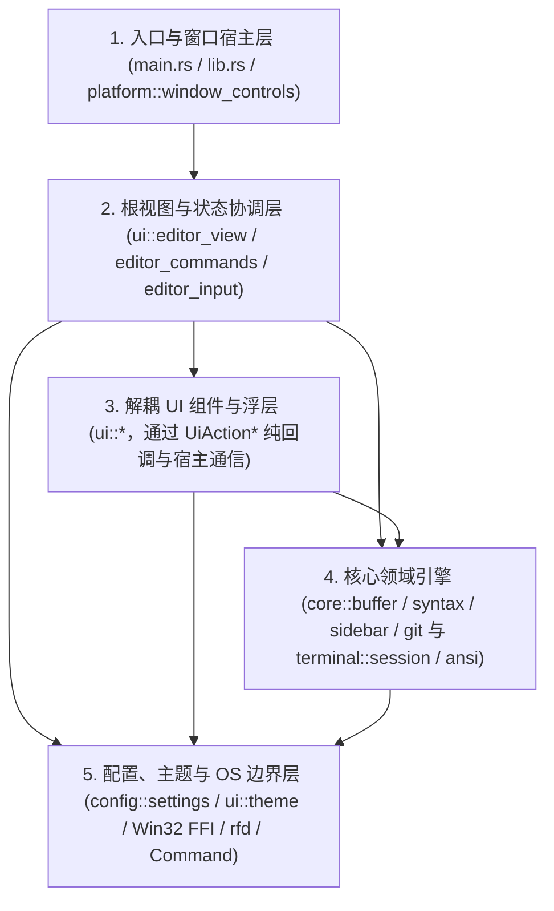
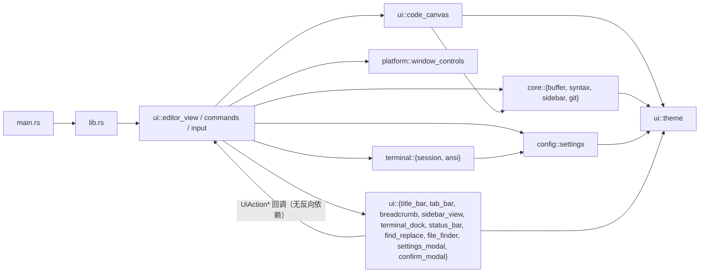
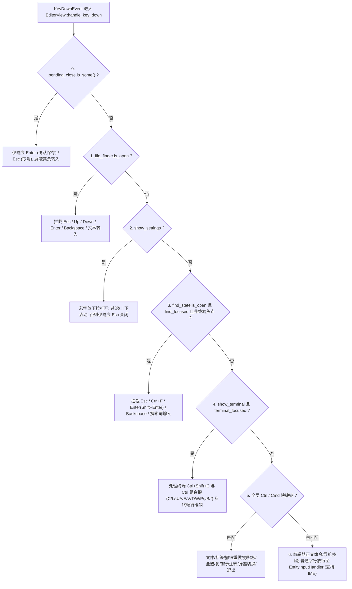
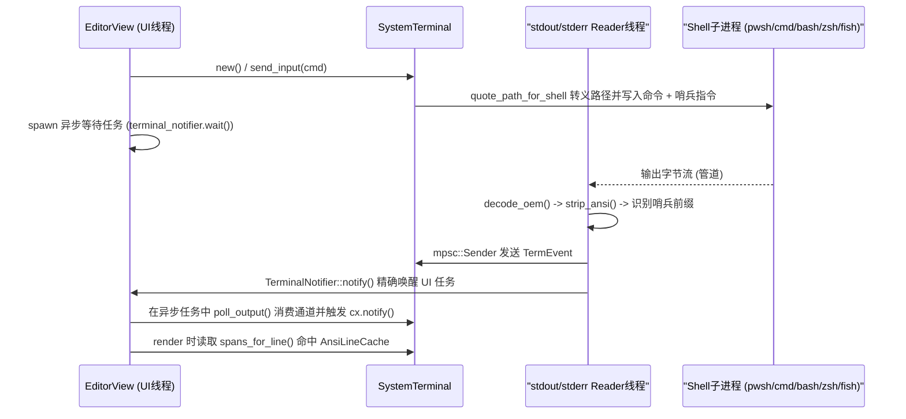

# bmvp-text 整体架构文档

> 本文档基于当前仓库源码梳理，描述 `bmvp-text` 的设计原则、分层架构、模块职责、核心子系统实现、CI/CD 发布体系以及目标重构演进蓝图。  
> 针对当前代码中已识别的缺陷、性能瓶颈与待完善项，请参阅配套文档 [optimization-roadmap.md](optimization-roadmap.md)。

---

## 1. 项目概述与设计原则

### 1.1 项目定位
`bmvp-text` 是一个完全参考 **Zed** 页面设计语言与交互体验的极致轻量级文本/代码编辑器，基于 **Pure Rust (Edition 2024) + GPUI 0.2** 构建。

### 1.2 核心技术栈（来自 `Cargo.toml`）

| 依赖 Crate | 版本 | 用途 |
| :--- | :--- | :--- |
| `gpui` | `0.2` | 跨平台 GPU 加速 UI 框架与窗口/事件/字体系统 |
| `ropey` | `1.6` | Rope 数据结构，用于大文本切片、行索引与编辑 |
| `anyhow` | `1.0` | 通用错误处理类型 |
| `rfd` | `0.18.0` | 原生系统文件/文件夹打开与保存对话框 |
| `walkdir` | `2.5.0` | 工作区目录递归扫描（用于 `FileFinder`） |
| `serde` / `serde_json` | `1.0` | 主题与编辑器配置的 JSON 序列化与反序列化 |
| `raw-window-handle` | `0.6` | 获取底层窗口句柄以实现 Windows 原生窗口拖拽与控制 |
| `regex` | `1` | 查找与替换中的正则表达式匹配支持 |

### 1.3 架构约束与非目标
- **轻量与秒开优先**：保持直接依赖精简，避免引入重量级运行时、内置浏览器内核或复杂的插件沙箱。
- **零 AI 膨胀 / 零重量级 LSP 消耗**：专注于高响应的本地文件浏览、文本编辑、轻量词法着色与内嵌系统 Shell。
- **跨平台可构建**：需保证在 Windows (`x86_64-pc-windows-msvc`)、macOS (`aarch64-apple-darwin` / `x86_64-apple-darwin`) 与 Linux (`x86_64-unknown-linux-gnu`) 三端编译与通过 CI 检查。
- **Release 体积与性能约束**：在 `Cargo.toml` 中启用 `opt-level = 3`、`lto = "thin"`、`codegen-units = 1`、`panic = "abort"` 与 `strip = true`。

---

## 2. 整体分层架构

当前项目采用以 `EditorView` 为核心状态协调者的 5 层架构：



- **入口与窗口宿主层**：`main.rs` 解析 CLI 参数并初始化 GPUI `Application`、无边框窗口与 `on_window_should_close`；`lib.rs` 统一导出纯逻辑与视图模块供桌面端与 `tests/` 复用；`platform::window_controls` 封装跨平台窗口控制。
- **根视图与状态协调层**：按职责拆分为 `editor_view.rs`（结构体状态与组合渲染）、`editor_commands.rs`（文件对话框、标签页、查找替换与剪贴板命令）、`editor_input.rs`（鼠标/键盘路由与 `EntityInputHandler` IME 输入）。
- **解耦 UI 组件与浮层**：`TitleBar`、`TabBar`、`BreadcrumbBar`、`SidebarView`、`TerminalDock`、`StatusBar`、`FindState`、`FileFinder`、`SettingsModal`、`ConfirmModal` 全部通过 `src/ui/mod.rs` 中的 `UiAction` / `UiAction1` / `UiAction2` / `UiMouseAction` 回调结构体与宿主解耦，不再反向持有 `Context<EditorView>`。
- **核心领域引擎**：由 `core::{buffer, syntax, sidebar, git}` 与 `terminal::{session, ansi}` 组成，提供纯内存/无窗口可测的文本编辑、行级词法高亮缓存、增量目录树、Git 分支探测、ANSI 解析缓存与非阻塞 Shell 会话管理。
- **配置、主题与 OS 边界层**：负责 `settings.json` 读写（`#[serde(default)]` 向后兼容）、含独立 `SyntaxColors` 的 4 套主题、`rfd` 异步对话框、Win32 FFI 与子进程/文件系统交互。

---

## 3. 目录结构与模块职责矩阵

### 3.1 仓库目录概览

| 路径 | 所属层级 | 核心职责 |
| :--- | :--- | :--- |
| `src/main.rs` | 入口层 | 精简二进制入口：解析 CLI `StartupArgs`，启动 GPUI `Application` 与主窗口并注册 `on_window_should_close` |
| `src/lib.rs` | 库导出层 | 统一暴露 `core`、`config`、`platform`、`terminal`、`ui` 与 `StartupArgs`/`parse_startup_args` |
| `src/core/buffer.rs` | 核心引擎 | `TextBuffer`（Rope 编辑、UTF-8/UTF-16 索引、`revision` 脏状态、原子保存、查找替换与单元测试） |
| `src/core/syntax.rs` | 核心引擎 | 单行词法扫描 `highlight_line`、行内容哈希缓存 `HighlightCache` 与主题化 `token_color` |
| `src/core/sidebar.rs` | 核心引擎 | 项目目录树 `Sidebar`、`FileNode`，支持增量 `toggle_expand`、`.gitignore` 过滤与滚动夹紧 |
| `src/core/git.rs` | 核心引擎 | 向上遍历 `.git/HEAD`（含 worktree gitfile 与 detached HEAD）检测当前分支 |
| `src/core/logging.rs` | 核心引擎 | 零依赖轻量结构化日志工具（`LogLevel`、`format_log_line`、`info`/`warn`/`error`） |
| `src/terminal/session.rs` | 终端引擎 | `SystemTerminal`、`TerminalNotifier` 跨线程事件唤醒、`ShellKind`、PATH 可执行文件探测、`AnsiLineCache` 与后台清理 |
| `src/terminal/ansi.rs` | 终端引擎 | ANSI SGR 16/256/TrueColor + 粗体/斜体/下划线/反显解析、`strip_ansi` 单遍剥离、OEM/Base64 解码 |
| `src/config/settings.rs` | 配置层 | `AppConfig` 与 `EditorSettings`（结构体级 `#[serde(default)]`、Windows/macOS/Linux 配置目录与默认字体/Shell、`save_to_path`） |
| `src/platform/window_controls.rs` | 平台边界 | Win32 / macOS / Linux 原生窗口控制、macOS 交通灯间距与 `PRIMARY_MODIFIER_LABEL` 封装 |
| `src/ui/mod.rs` | UI 基础 | UI 子模块声明与共享回调别名（`UiAction` / `UiAction1` / `UiAction2` / `UiMouseAction`） |
| `src/ui/theme.rs` | UI 主题 | 四套 `ThemeMode`（`ZedLight`/`ZedDark`/`OneDark`/`Nord`）与各自独立的 `SyntaxColors` 色板 |
| `src/ui/editor_view.rs` | 根视图层 | `EditorView` 状态字段、初始化、回调组装与 `Render` 布局调度 |
| `src/ui/editor_commands.rs` | 根视图层 | 标签页生命周期、未保存退出保护、文件对话框、查找替换、剪贴板与异步文件查找命令 |
| `src/ui/editor_input.rs` | 根视图层 | 鼠标拖拽选区/缩放、7 级键盘路由与 `EntityInputHandler` IME 输入法对接 |
| `src/ui/code_canvas.rs` | UI 组件 | GPUI 自定义 `Element` `CodeCanvas` 与 `CodeLayoutState`，结合 `HighlightCache` 绘制代码行与选区/光标 |
| `src/ui/title_bar.rs` / `tab_bar.rs` / `breadcrumb.rs` | UI 组件 | 顶部标题栏、多标签页栏与工作区面包屑栏（纯回调解耦） |
| `src/ui/sidebar_view.rs` / `terminal_dock.rs` / `status_bar.rs` | UI 组件 | 侧边栏视图、支持横向滚动与快捷复制的终端停靠栏、状态栏（纯回调解耦） |
| `src/ui/find_replace.rs` / `file_finder.rs` / `settings_modal.rs` / `confirm_modal.rs` | UI 浮层 | 查找替换条、后台异步扫描+模糊打分排序 `FileFinder`、设置弹窗与未保存确认弹窗（纯回调解耦） |
| `.github/workflows/` | CI/CD | `ci.yml`（三端 check/test/clippy/fmt）与 `release.yml`（tag 正式发布与 `main` `dev-latest` 预发布） |
| `scripts/` 与 `package/windows/` | 打包脚本 | `package-windows.ps1` / `package-macos.sh` / `package-linux.sh` 与 Inno Setup 安装包配置 |
| `tests/core_integration.rs` | 集成测试 | 纯内存/临时目录跨模块集成测试（缓存、主题、目录增量展开、模糊搜索、ANSI、Shell 转义、Git、配置兼容） |

### 3.2 模块依赖关系（单向无环解耦）



---

## 4. 核心子系统设计

### 4.1 文本缓冲区（`src/core/buffer.rs`）
- **底层存储**：基于 `ropey::Rope` 存储文本，支持大文件下的局部修改与按行查询（`line`、`line_to_char`、`char_to_line`）。
- **坐标与选区模型**：
  - `Position { row, col }` 表示 0 基行列位置。
  - `Selection { anchor, head }` 使用字符索引（char index）表示选区起止，支持反向拖选（`range()` 自动取 `min..max`）。
- **历史栈（Undo/Redo）**：
  - 使用 `VecDeque<HistoryEntry>`（上限 `120` 步），基于 `revision` 与 `saved_revision` 精确判断 `is_dirty()`（撤销回保存点自动恢复未修改态），并支持 500ms 同类单字符输入/退格合并与空操作去重。
- **文件与元信息**：
  - `open_file` 先读取字节并显式校验 UTF-8；`save_file` 采用同目录临时文件 + `sync_all` + `rename` 原子替换并同步 `saved_revision`。
  - `language()` 根据文件后缀（`.rs`、`.toml`、`.md`、`.json`、`.py`、`.js/.jsx`、`.ts/.tsx`、`.html`、`.css`、`.sh/.bash`、`.c/.h`、`.cpp/.hpp`）返回语言名称，无文件路径的未命名缓冲区默认为 `"Rust"`。
  - `line_ending()` 检查第 0 行末尾是否为 `\r\n` 返回 `"CRLF"` 或 `"LF"`。
  - `find_matches_with_options()` 支持大小写敏感、全词匹配与正则表达式查找，并配套 `replace_range_match` / `replace_all_matches`。

### 4.2 词法语法高亮与行级缓存（`src/core/syntax.rs`、`src/ui/theme.rs`）
- **工作方式**：纯函数 `highlight_line(line: &str, lang: &str) -> Vec<SyntaxToken>`，按单行无状态扫描，并由 `HighlightCache::get_or_highlight` 按行内容哈希与语言缓存分词结果（上限 `1024` 条），避免每帧重复扫描未修改行。
- **Token 分类（`TokenType`）**：`Default`、`Keyword`、`Type`（首字母大写的标识符）、`Function`（后跟 `(` 的标识符）、`StringLiteral`、`NumberLiteral`、`Comment`（`//` 或针对 Python/TOML/Shell 的 `#`）、`Operator`。
- **主题化配色映射**：`Theme` 结构体新增独立 `SyntaxColors` (`theme.syntax`)，`token_color(token_type, theme)` 直接读取当前主题的语法色板，使 `ZedLight`、`ZedDark`、`OneDark`、`Nord` 拥有各自差异化的语法高亮配色。

### 4.3 UI 布局与渲染管线（`src/ui/`）
- **顶层视觉结构**：
  - 根容器为水平 `flex_row`：左侧为可折叠的 `SidebarView` 面板与 2px 宽 `cursor_col_resize` 拖拽分隔条；右侧为 `flex_1` 纵向主区域。
  - 右侧主区域从上到下依次堆叠：
    1. `TitleBar`（`title_bar.rs`，32px）：侧边栏开关、项目名、空白拖拽区（单击拖拽窗口、双击最大化/还原）、快捷按钮及自定义窗口控制按钮。
    2. `TabBar`（`tab_bar.rs`，32px）：左右切换箭头、文件标签页（Dirty 圆点与 `×` 关闭按钮）、新建 `+` 按钮。
    3. `BreadcrumbBar`（`breadcrumb.rs`，28px）：相对工作区路径面包屑及右侧工具按钮（查找、行号开关、终端、设置）。
    4. `EditorPane`（`flex_1`）：左侧 54px 行号栏（可选）+ 右侧 `CodeCanvas`（`code_canvas.rs`）精确排版画布（按 Tab 独立的 `scroll_top`/`scroll_left` 动态计算可见行，复用 `HighlightCache` 绘制高亮、选区/查找/竖线光标叠加、拖拽选区与 IME 候选窗定位）；右上角绝对定位叠加 `FindState`（`find_replace.rs`）查找替换浮层。
    5. `TerminalResizer` 与 `TerminalDock`（`terminal_dock.rs`）：支持多终端 Tab、运行态指示、`AnsiLineCache` 着色、`Ctrl+Shift+C` 复制最近输出、鼠标左键滚动及 `Shift + 滚轮` 横向滚动。
    6. `StatusBar`（`status_bar.rs`，26px）：底部状态栏。
  - 最外层通过 `modal_overlay` / `confirm_overlay` 条件叠加异步扫描的 `FileFinder`（`file_finder.rs`）、`SettingsModal`（`settings_modal.rs`）或 `ConfirmModal`（`confirm_modal.rs`）。
- **原生窗口控制（`src/platform/window_controls.rs`）**：Windows 下通过 `raw-window-handle` 提取 `HWND`，调用 `user32` 的 `ShowWindowAsync`、`IsZoomed`、`ReleaseCapture`、`SendMessageW(..., WM_NCLBUTTONDOWN, HTCAPTION, ...)` 实现平滑无边框拖拽与最大化；非 Windows 平台回退至 GPUI 内置窗口方法。

### 4.4 键盘事件路由与 7 级焦点分层
`EditorView::handle_key_down`（位于 `src/ui/editor_input.rs`）采用自顶向下的截获链，根据弹窗与焦点状态决定按键归属：



### 4.5 内嵌系统终端与事件驱动通知（`src/terminal/`）
`SystemTerminal` 通过标准输入/输出/错误管道驱动常驻 Shell 子进程（`pwsh`、`powershell`、`cmd`、`bash`、`zsh`、`fish`），并采用 `TerminalNotifier` 异步事件唤醒替代固定定时轮询：



- **哨兵协议与路径安全**：每次命令后附加输出 `__BMVP_DONE__<当前工作目录>__`，PowerShell 额外附加 Base64 编码的原生 `prompt()` 输出 `__BMVP_PROMPT__<base64>__`；工作目录切换通过 `quote_path_for_shell` 针对不同 Shell 安全转义。
- **编码与渲染**：`ansi.rs` 提供 `decode_oem`、单遍 `strip_ansi` 与 `parse_ansi_spans`（支持 SGR 16 色/256 色/TrueColor 及粗体 SGR 1/斜体 SGR 3/下划线 SGR 4/反显 SGR 7），并由 `SystemTerminal::spans_for_line` 缓存结果；`input_buffer` 使用字节偏移原地 `String::insert`/`remove`。
- **生命周期与非阻塞退出**：启动探测使用纯内存 `find_executable_in_path` 扫描 `PATH`；`Drop` 与 `kill_session` 将进程树结束与 `wait()` 下沉到后台线程，不阻塞 UI 主线程。

### 4.6 配置与主题系统（`src/config/settings.rs`、`src/ui/theme.rs`）
- **配置持久化**：`AppConfig` 与 `EditorSettings` 均启用结构体级 `#[serde(default)]`，缺省字段与旧版配置均可无损兼容升级；`resolve_config_path_for` 按操作系统分别解析至 Windows（`%APPDATA%\bmvp-text\settings.json` / `%USERPROFILE%\.bmvp-text\settings.json`）、macOS（`~/Library/Application Support/bmvp-text/settings.json`）与 Linux（`$XDG_CONFIG_HOME/bmvp-text/settings.json` / `~/.config/bmvp-text/settings.json`），并通过临时文件原子替换写盘与显式错误返回。
- **主题系统**：内置 `ZedLight`、`ZedDark`、`OneDark`、`Nord` 四套 `ThemeMode`，每套均定义背景层级、边框、文字、状态色与独立的 `SyntaxColors` 语法高亮色板。

---

## 5. 构建、测试与 CI/CD 发布架构

- **持续集成（`.github/workflows/ci.yml`）**：
  - 触发条件：`push` 到 `main`/`develop`，或针对 `main` 的 `pull_request`。
  - 跨平台矩阵：`windows-latest`、`ubuntu-22.04`（安装 Vulkan/Wayland/X11/GTK3/FreeType 等 GPUI 系统依赖）、`macos-latest`。
  - 门禁命令：`cargo check --all-targets`、`cargo test --all-targets`、`cargo clippy --all-targets -- -D warnings` 与 `cargo fmt --all -- --check`。
- **持续交付（`.github/workflows/release.yml`）**：
  - 触发条件：推送 `v*` 标签（正式 Release）、`main` 分支 CI 成功后触发 `workflow_run`（更新滚动 `dev-latest` Pre-release）或手动 `workflow_dispatch`。
  - 统一打包：CI 统一调用 `scripts/package-windows.ps1`、`scripts/package-macos.sh`、`scripts/package-linux.sh`（支持 `-SkipBuild` / `SKIP_BUILD=1`），消除 CI 与本地脚本漂移，生成 Windows `.zip`（本地支持 `-BuildInstaller` 编译含 PATH 注册的 Inno Setup 安装向导）、macOS `.dmg`/`.tar.gz` 与 Linux `.tar.gz`/`.deb`。
- **本地打包脚本（`scripts/`）**：提供 `package-windows.ps1`、`package-macos.sh`、`package-linux.sh`。

---

## 6. 已落地模块化目录结构

经过 P2 与 P3 迭代重构，`src/editor.rs` 的单文件膨胀、组件耦合及跨平台工程短板已全面修复，当前目录结构如下：

```text
src/
├── main.rs                    # 命令行参数解析（StartupArgs）、GPUI 应用引导与窗口创建（含 macOS 交通灯位置）
├── lib.rs                     # 导出 core / config / platform / terminal / ui 供应用与 tests/ 调用
├── core/
│   ├── mod.rs
│   ├── buffer.rs              # TextBuffer（UTF-8/CRLF 安全、增量 Undo/Redo、原子保存、查找替换）
│   ├── syntax.rs              # 无状态词法扫描器与按行 HighlightCache 缓存
│   ├── sidebar.rs             # 项目目录树增量展开/折叠模型与 .gitignore 过滤
│   ├── git.rs                 # .git/HEAD（含 worktree 与 detached HEAD）分支探测
│   └── logging.rs             # 轻量结构化日志输出（info / warn / error）
├── terminal/
│   ├── mod.rs
│   ├── session.rs             # SystemTerminal 会话、TerminalNotifier 事件唤醒、AnsiLineCache、三端外部终端
│   └── ansi.rs                # ANSI SGR（含 1/3/4/7 样式）解析、strip_ansi 与 OEM/Base64 解码
├── config/
│   ├── mod.rs
│   └── settings.rs            # 配置读写与 #[serde(default)] 向后兼容反序列化
├── platform/
│   ├── mod.rs
│   └── window_controls.rs     # Win32 / 非 Windows 原生窗口控制封装
└── ui/
    ├── mod.rs                 # UI 子模块与共享回调类型别名（UiAction* / UiMouseAction）
    ├── editor_view.rs         # EditorView 状态字段、初始化、回调组装与 Render 布局
    ├── editor_commands.rs     # 标签页、文件对话框、查找替换与剪贴板命令
    ├── editor_input.rs        # 鼠标选区/拖拽、7 级键盘路由与 EntityInputHandler IME
    ├── code_canvas.rs         # GPUI 自定义画布（精确命中、光标、选区与 HighlightCache 绘制）
    ├── title_bar.rs           # 顶部栏与窗口控制条
    ├── tab_bar.rs             # 多标签页切换栏
    ├── breadcrumb.rs          # 工作区相对路径面包屑
    ├── terminal_dock.rs       # 底部多终端停靠栏（支持 Shift+滚轮横向滚动与 Ctrl+Shift+C）
    ├── sidebar_view.rs        # 项目树侧边栏视图
    ├── file_finder.rs         # 快速文件查找弹窗（后台异步扫描 + fuzzy_score 排序）
    ├── find_replace.rs        # 查找替换浮层
    ├── settings_modal.rs      # 偏好设置弹窗（含 zsh/fish 选项与字体搜索）
    ├── confirm_modal.rs       # 未保存更改退出/关闭确认弹窗
    ├── status_bar.rs          # 底部状态栏
    └── theme.rs               # 含独立 SyntaxColors 语法色板的四套主题定义
tests/
└── core_integration.rs        # 跨模块纯内存/临时目录集成测试
```

**已落地的解耦通信原则**：
- UI 子组件不持有 `Context<EditorView>`，而是通过 `UiAction` / `UiAction1` / `UiAction2` / `UiMouseAction` 回调结构体向 `EditorView` 发送用户意图，并由 `EditorView` 在 `cb0`/`cb1`/`cb2` 中统一调度。
- 后台线程/异步任务不捕获瞬态数组下标（如 `active_tab`、`active_terminal`），而是绑定稳定 ID（如 `tab_id`、`scan_generation`）。
